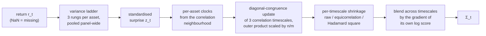

# Squeeze Kernel Covariance Estimator

[](https://github.com/r0k3/squeeze-kernel/actions/workflows/ci.yml)
[](https://pypi.org/project/squeeze-kernel/)
[](https://pypi.org/project/squeeze-kernel/)
[](LICENSE)
[](https://doi.org/10.5281/zenodo.19170801)
[](https://ssrn.com/abstract=6455918)

**A streaming covariance estimator for panels of financial returns that beats every fitted baseline out of sample, costs half a millisecond to ten milliseconds a day, and has one parameter.**

```python
from squeeze_kernel import SqueezeKernel

sk = SqueezeKernel(lam=0.996)        # the entire public surface
for r_t in returns:                  # NaN marks missing assets
    sk.update(r_t)
cov = sk.covariance()                # positive semi-definite by construction, every day
```

- **State of the art, measured.** On thirty years of S&P 500 constituents it leads ten baselines fitted to the data (CM-IEWMA, DCC, DCC-NL, nonlinear shrinkage, Ledoit–Wolf, OAS, RMT denoising, Gerber, IEWMA, EWMA) at every universe size from 50 to 300, every Diebold–Mariano *p* below 10⁻⁷, and it is the **sole member of the 90% model confidence set at every size**. With its configuration frozen on data to 2021 it stays first on 2022–2026, on **twenty-four sealed small- and mid-cap universes it had never seen**, on a 121-instrument futures panel across eight asset classes, and on the public Fama–French 49 panel on the competing authors' own metric.
- **Fast, with nothing that can fail.** One `O(Kn²)` state update, one Cholesky factorisation of the blend and `K` positive-definiteness checks a day. No rolling window, no likelihood refit, no daily solver. **0.54 ms a day at n = 50, 10.1 ms at n = 300.** The closest competitor on accuracy, CM-IEWMA as released by its authors, takes 18 to 51 times as long and spends most of it in a convex programme that is infeasible on about one scored day in five at n = 300.
- **One number, no tuning.** Everything else is derived from `lam`, fixed by a structural argument, or computed online from the estimator's own state. Listings, delistings and halts enter as `NaN`. Only dependency: NumPy.

Paper: Kende (2026), *The Squeeze Kernel Covariance Estimator*, [SSRN 6455918](https://ssrn.com/abstract=6455918). Every number on this page is taken from the tables of the paper's September 2026 revision, *A Diagonal-Congruence Flow in Per-Asset Trading Time*, which describes the 3.x estimator and carries the protocol, the proofs and the full ablation ledger.

[Benchmarks](#benchmarks) · [See the difference](#see-the-difference) · [Installation](#installation) · [Quickstart](#quickstart) · [How it works](#how-it-works) · [Citation](#citation)

## Why

Markets do not keep calendar time. Following Mandelbrot, the estimator treats a panel as a collection of partially coupled markets, **each advancing on its own activity-driven clock**, and reads those clocks from the panel's own correlation structure: a hot cluster (say precious metals and FX) advances its correlation state while an idle one (agriculture) does not, and nobody has to identify the cluster. On those clocks it runs a single recursion that **learns in market time and forgets in calendar time**, shrinks itself from two online statistics, and re-weights its three timescales by the gradient of its own log score. Nothing is fitted but `lam`.

Against the field it is scored on:

| | Squeeze Kernel | CM-IEWMA (as released) | DCC, DCC-NL | Window shrinkage (LW, OAS, NLS, RMT) |
|---|---|---|---|---|
| Clock | per-asset market clocks | calendar | calendar | calendar window |
| Daily work | `O(Kn²)` update, one Cholesky, no solver | daily convex programme | GARCH recursion | re-estimate on the window |
| Tuned in the paper | nothing: `lam = 0.996`, fixed on data to 2021 | fitted on a tuning block, re-fitted to each sealed universe | fitted on a tuning block, re-fitted to each sealed universe | fitted on a tuning block, re-fitted to each sealed universe |
| Milliseconds a day, n = 50 → 300 | **0.54 → 10.1** | 18.8 → 182.2 | 0.05 → 0.83, 0.09 → 1.83 | not timed |
| Days the solver fails, n = 300 | no solver | 1,196 of 6,439 scored | — | — |

## Benchmarks

The score is the one-step-ahead Gaussian negative log-likelihood (NLL) of the next day's returns under each estimator's forecast, averaged per day; lower is better. Every baseline is fitted on a tuning block before it is scored. The ranking holds under the Student-t and density-power scores as well.

### Thirty years of S&P 500 constituents, 1995–2026

Each baseline's row is its **excess NLL per day over the Squeeze Kernel**. Every Diebold–Mariano *p* is below 10⁻⁷. The Squeeze Kernel is the sole member of the 90% model confidence set at every size.

| | n = 50 | n = 100 | n = 200 | n = 300 |
|---|---:|---:|---:|---:|
| **Squeeze Kernel, average NLL** | **−371.28** | **−753.21** | **−1539.32** | **−2334.88** |
| CM-IEWMA | +1.63 | +4.58 | +12.45 | +20.70 |
| DCC | +2.04 | +5.31 | +13.49 | +25.38 |
| DCC-NL | +2.21 | +5.53 | +13.90 | +24.67 |
| RMT denoising | +6.60 | +14.72 | +32.39 | +58.94 |
| Gerber (PSD) | +7.00 | +15.61 | +38.82 | +62.98 |
| Nonlinear shrinkage | +6.29 | +16.10 | +42.84 | +73.22 |
| IEWMA | +3.98 | +16.56 | +79.79 | +224.73 |
| EWMA | +7.10 | +19.92 | +58.71 | +80.81 |
| Ledoit–Wolf | +6.75 | +20.44 | +60.42 | +98.94 |
| OAS | +8.44 | +23.96 | +66.04 | +106.56 |

### Out of sample, configuration frozen on data to 2021

| | n = 50 | n = 100 | n = 200 | n = 300 |
|---|---:|---:|---:|---:|
| **S&P constituents, 2022–2026**: lead over the best baseline (CM-IEWMA at every size), NLL per day | 1.72 | 3.72 | 11.12 | 19.16 |
| **Twenty-four sealed small- and mid-cap universes**, six per size, 2022–2026, field fitted to each universe: universes on which it is first | 6 of 6 | 6 of 6 | 6 of 6 | 6 of 6 |
| lead over the best baseline, range | 0.1–1.2 | 2.7–4.0 | 8.6–10.9 | 13.2–17.5 |
| sole member of the 90% model confidence set | 1 of 6 | 6 of 6 | 6 of 6 | 6 of 6 |

Carried **zero-shot** to other panels, same `lam`:

| Panel | Result |
|---|---|
| **121 futures**, eight asset classes, held out from mid-2018, baselines calibrated on that panel's own history | first; leads DCC-NL by 11.3 NLL per day (*p* = 10⁻⁸), IEWMA by 14.4, DCC by 18.2, EWMA by 36.0, Ledoit–Wolf by 121.4 |
| **Fama–French 49 industries**, scored with the CM-IEWMA authors' own regret metric (lower is better) | **16.35**, against CM-IEWMA 16.96, IEWMA 18.20, EWMA 19.39 |

### Cost

Milliseconds per forecast day, single-threaded, over the full thirty-year pass:

| | n = 50 | n = 100 | n = 200 | n = 300 |
|---|---:|---:|---:|---:|
| **Squeeze Kernel** | **0.54** | **0.91** | **2.80** | **10.1** |
| CM-IEWMA as released | 18.8 | 46.4 | 106.8 | 182.2 |
| of which the daily convex programme | 16.1 | 39.9 | 85.4 | 142.1 |
| days on which the programme fails | 0 | 50 | 294 | 1,196 |
| peak memory, GB | 2.0 | 6.4 | 22.4 | 45.3 |
| DCC | 0.05 | 0.11 | 0.28 | 0.83 |
| DCC-NL | 0.09 | 0.25 | 0.92 | 1.83 |

Two honest footnotes. The released CM-IEWMA code overstates what the method has to cost: its linear algebra alone, with the programme treated as free, would run in 60% to 121% of the Squeeze Kernel's time. The cost is the solver, and so is the fragility. And DCC and DCC-NL are cheaper than both; they are also 13 to 25 NLL per day behind at n = 200 and 300.

## See the difference

A passive strategy any allocator would recognise: long-only minimum-variance over 300 liquid US stocks, scaled to a 15% volatility target, rebalanced monthly, 5 bps costs. Two runs on identical data; the only difference is the covariance matrix. The Squeeze Kernel arm runs `SqueezeKernel(lam=0.996)`, **nothing tuned on this panel**.

<picture>
  <source media="(prefers-color-scheme: dark)" srcset="https://raw.githubusercontent.com/r0k3/squeeze-kernel/main/examples/figures/vol_targeted_portfolio_dark.png">
  
</picture>

| Method | CAGR | Vol | Sharpe | MaxDD | Calmar | Vol-target RMSE |
|---|---|---|---|---|---|---|
| **Squeeze Kernel (default)** | **12.6%** | **13.6%** | **0.92** | **-34.3%** | **0.37** | **7.05%** |
| Ledoit-Wolf (252d) | 11.7% | 14.6% | 0.80 | -38.7% | 0.30 | 7.51% |

Reproduce from the repo alone (the 300-stock panel ships as a parquet; survivorship and provenance are documented in the script):

```bash
pip install squeeze-kernel pandas pyarrow scikit-learn matplotlib
python examples/vol_targeted_portfolio.py    # ~1 minute for the 26-year stream
```

## Installation

```bash
pip install squeeze-kernel          # NumPy only
pip install "squeeze-kernel[full]"  # + SciPy (faster Cholesky factorisations for the mixture)
```

## Quickstart

```python
import numpy as np
from squeeze_kernel import SqueezeKernel, estimate_squeeze_cov

returns = np.random.default_rng(42).normal(0.0, 0.01, size=(500, 30))

sk = SqueezeKernel()                 # lam=0.996 (anchor half-life ~173 days)
for r_t in returns:
    w = sk.update(r_t)               # returns the day's kernel weight
cov, corr = sk.covariance(), sk.correlation()
sk.state()                           # kernel scale, per-timescale effective sizes, mixture tilt

# batch mode: full panel in, covariance path out
cov_path, corr_path, weights = estimate_squeeze_cov(returns, with_weights=True)
```

Missing values: pass `NaN` (or `mask=` on `update`). Newly listed, delisted or halted assets need no imputation and no complete-case subsetting.

Units: pass returns in decimal units (`0.01` = 1%). The numerical floors are absolute (`ε = 1e-8` in squared-return units), so percent-unit returns give a different path. A panel whose first day carries many exact-zero returns starts with a transient that the slow timescale remembers; start a day later.

## How it works



One daily update, in words:

1. **Volatility with self-selected memory.** Each asset's variance runs on a three-rung ladder of half-lives (`h/16, h/4, h`), pooled panel-wide by weights that move on saturated evidence, so one spike day cannot hand a stale rung weeks of weight. The day's return is standardised by it.
2. **Per-asset clocks.** Each asset reads its activity as the neighbourhood mean of squared surprises, weighted by the Hadamard square of yesterday's correlation (under conditional Gaussianity that square *is* the correlation of squared returns, so the neighbourhood is the asset's own cluster, no labels needed). A saturating kernel maps activity to a clock increment in `[0, 1)`: an unbounded shock is squeezed into at most one unit of trading time.
3. **Magnitude once, direction once.** The day's Mahalanobis norm under the estimator's own forecast, `m = r'Σ⁻¹r`, sets the clocks; the innovation then enters with weight `n/m`, so a day's direction moves the state and its size only says how much trading time it carried. Score-driven and robust estimators down-weight such a day as contamination; this one reads it as time.
4. **Diagonal-congruence flow on three timescales.** Each correlation state advances by a congruence plus a rank-one term on the clocks, with decays `(lam⁴, lam, lam^¼)`. In closed form it is an exponentially weighted Gram matrix of clock-weighted returns: pairs accrue at the geometric mean of their two clock increments, which is exactly the Cauchy–Schwarz bound on how far two clocks can overlap and the most positive semi-definiteness allows. No eigenvalue clipping, no nearest-PSD repair, any missing-data pattern.
5. **Self-tuning, label-free shrinkage.** Each timescale's shrunk correlation is a pool of its raw correlation, its equicorrelation level and its Hadamard square. The Hadamard square suppresses cross-cluster noise quadratically (0.10 → 0.01) while keeping intra-cluster blocks (0.60 → 0.36). The pool's prior weights come from a closed-form intensity rule read off two online statistics; the blend gradient corrects them.
6. **Blend by the gradient of the blend's own score.** The timescale weights follow an exponentiated-gradient step on the blend's log score (not any single timescale's, which would select rather than blend), at a temperature calibrated so that uninformative evidence leaves the mix within a factor *e* of its prior. Nothing in either mixture is fitted.

The paper gives the derivations (natural-gradient and Gram-matrix forms of the flow, the Fisher–Rao form of the mixture), the guarantees (PSD at every step, a conditioning floor, strict positive definiteness whenever a positively weighted timescale has its intensity strictly inside (0, 1), exact reductions to the published special cases) and the full evaluation.

### What derives from `lam`

| quantity | value |
|---|---|
| timescale ladder | decays `(lam⁴, lam, lam^¼)` — half-lives `(h/4, h, 4h)`, `h = -1/log2(lam)` |
| kernel scale | state: `κ_t = ⅓ · EWMA(activity)` at the anchor rate |
| shrinkage intensity | per timescale, `α = min(1,c) · g̃²/(g̃² + (1−g̃)²·max(0, 1/c − 1))` from the online concentration `c = n/ν` and target-fit `g̃` |
| timescale weights | prior ∝ √h, moved by exponentiated gradient on the blend log score at the null temperature, fast-rung memory |
| shrinkage split | per timescale, a learned pool of the raw correlation, its equicorrelation level and its Hadamard square; prior `(1−α, α(1−α), α²)`, moved by the blend gradient |
| observation weight | state: `ω_t = n_t/m_t`, the day's observed count over its Mahalanobis distance under yesterday's forecast, from the mixture's own factorisation |
| volatility memory | ladder `(h/16, h/4, h)`, pooled panel-wide by the same rule on tanh-saturated evidence, uniform prior |
| structural constants | K=3, b=4, θ=½, κ-scale ⅓, Schur power 2, intensity exponent 2 — each bracketed by ablation in the paper |
| fitted constants | `lam` itself (0.996, chosen on data to 2021); nothing else is fitted |

`from squeeze_kernel import CONSTANTS` exposes the structural constants for research. The published v1 estimator (all its knobs) remains available as `SqueezeKernelEstimator` / `SqueezeKernel.v1(...)`; every mechanism since 2.0 is also an estimator-level switch for ablation. See [MIGRATION.md](MIGRATION.md).


## Development

```bash
uv sync --extra full --extra dev
uv run python -m pytest        # test suite
uv run python -m ruff check .  # lint
uv run mypy                      # strict type check (src/squeeze_kernel)
uv build                       # build sdist + wheel
```

## Citation

```bibtex
@article{kende2026squeeze,
  title  = {The Squeeze Kernel Covariance Estimator},
  author = {Kende, Robert},
  year   = {2026},
  note   = {Working paper. Available at SSRN: \url{https://ssrn.com/abstract=6455918}}
}
```

See also [`CITATION.cff`](CITATION.cff).

## License

MIT
